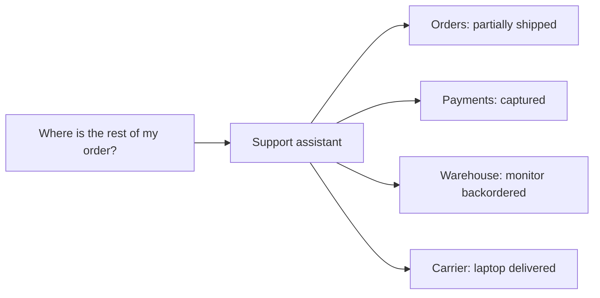
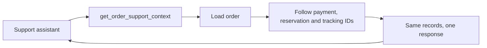

# Where is my order?

Imagine a customer ordering equipment for a new employee: a laptop and a monitor. The laptop arrives. The monitor doesn't. The order page still says *partially shipped*, so the customer opens a support chat.

> What is happening with my order? What has arrived, and when will the rest arrive?

A fairly ordinary question. Answering it means checking the order, confirming the payment, looking at warehouse reservations, and finding the right carrier update. Each system has a piece of the answer. None of them has the whole conversation.

This sounds like a useful job for an agent. Give it a few MCP tools, let it gather the facts, and ask it to explain what happened. The API endpoints already exist. How much more work could it be? 🤞

The question I want to explore is **where the gathering should happen**. Should the model follow every relationship between our services, or should C# assemble the evidence for the question we're trying to answer?



# From a chat to an agent

*Agent* is a big word for a fairly small mechanism. Before arguing about tool design, I want to open the box and look at what actually travels between the pieces. Every payload in this part comes from the companion's recorded runs or from its MCP server, trimmed only where noted.

## A chat is one request


A call to a model API is a stateless HTTP request. We send instructions and messages, and we get text back. The model knows what it learned in training and what is in the request. Nothing else.

Ask about `ORD-1004` here and the best possible answer is an honest *I can't see your order*. The worst one is a confident guess. The records we need live in our services, and none of them are in the request.

Even the *conversation* in a chat window is maintained by the client. Every new message is sent together with the whole history before it. Keep that in mind; it will matter when we count tokens.

## Tools: the model asks, your code acts


To let the model reach that data, we add tool definitions to the request. Each one is a name, a description and a JSON Schema for its arguments. This is `get_order` exactly as the model received it in the recorded run, which used OpenAI's Responses API:

```json
{
  "type": "function",
  "name": "get_order",
  "description": "Get one order's status, promised delivery date, item quantities and linked payment, reservation and tracking IDs. Follow those IDs with the other tools for payment, warehouse and carrier evidence. Order status may lag carrier updates.",
  "parameters": {
    "type": "object",
    "properties": {
      "orderId": {
        "description": "The order ID, for example ORD-1001.",
        "type": "string"
      }
    },
    "required": ["orderId"]
  },
  "strict": false
}
```

Now the model has a second way to respond. Instead of text, it can return a request to call a tool. Here is the output of the first response to our question, minus the item's own ID and status:

```json
{
  "type": "function_call",
  "name": "get_order",
  "arguments": "{\"orderId\":\"ORD-1004\"}",
  "call_id": "call_cqXeuxQPiA9BEepDEw5oVh2I"
}
```

**The model didn't run anything. It can't.** It produced a name and a string of JSON arguments, token by token, like any other text. Our code reads that request, decides whether to honour it, runs the tool and sends the result back in the next request. The `call_id` ties the result to the call (output trimmed):

```json
{
  "type": "function_call_output",
  "call_id": "call_cqXeuxQPiA9BEepDEw5oVh2I",
  "output": "…the get_order result, as text…"
}
```

Providers name these pieces differently, but the ideas are the same:

| | OpenAI Responses | Anthropic Messages | Microsoft.Extensions.AI |
| --- | --- | --- | --- |
| Tool definition | `tools[]` with `parameters` | `tools[]` with `input_schema` | `AIFunction` in `ChatOptions.Tools` |
| Model asks | `function_call` item | `tool_use` block | `FunctionCallContent` |
| We answer | `function_call_output` item | `tool_result` block | `FunctionResultContent` |
| Matched by | `call_id` | `id` / `tool_use_id` | `CallId` |

The companion goes through `IChatClient` from Microsoft.Extensions.AI, so the same C# code can talk to OpenAI or Anthropic models.

## Put it in a loop


One tool call is rarely enough. The order points to a payment, reservations and shipments, and the model only learns their IDs after reading the order. So we repeat: send the request, run whatever tools the model asked for, append the calls and results, and send again. We stop when the model answers with text instead of another tool call.

That loop is what we usually mean by an agent. Anthropic's [Building effective agents](https://www.anthropic.com/engineering/building-effective-agents) puts it plainly: agents "are typically just LLMs using tools based on environmental feedback in a loop." The same article contrasts them with *workflows*, "where LLMs and tools are orchestrated through predefined code paths". We'll come back to that distinction.

In C#, the loop fits on one screen. This is the core of the companion's evaluation runner, without its budgets, timing and error handling:

```csharp
var tools = await mcpClient.ListToolsAsync(); // MCP tools are AIFunctions
var options = new ChatOptions { Instructions = Instructions, Tools = [.. tools] };
List<ChatMessage> history = [new(ChatRole.User, question)];

while (true)
{
    var response = await chat.GetResponseAsync(history, options);
    history.AddRange(response.Messages);

    var calls = response.Messages
        .SelectMany(message => message.Contents)
        .OfType<FunctionCallContent>()
        .ToArray();
    if (calls.Length == 0)
        return response.Text; // the final answer

    history.AddRange(await Task.WhenAll(calls.Select(async call =>
    {
        var arguments = call.Arguments?.ToDictionary() ?? [];
        var result = await mcpClient.CallToolAsync(call.Name, arguments);
        return result.ToChatMessage(call.CallId);
    })));
}
```

Notice that `GetResponseAsync` receives the whole `history` every time. That is the stateless API from the first picture, now in a loop.

Microsoft.Extensions.AI can run this loop for you with `UseFunctionInvocation()`. The runner writes it out so it can count turns and tool calls and stop at a budget.

## Where MCP fits

The model never talks to the MCP server. Our runner does. It is the MCP *client*: it starts the server as a child process and speaks JSON-RPC to it over stdio. MCP standardizes the tool side of the loop, which is discovery and invocation.

At startup, the runner sends `tools/list`. This is the `get_order` entry the companion's server returns:

```json
{
  "name": "get_order",
  "description": "Get one order's status, promised delivery date, item quantities and linked payment, reservation and tracking IDs. Follow those IDs with the other tools for payment, warehouse and carrier evidence. Order status may lag carrier updates.",
  "inputSchema": {
    "type": "object",
    "properties": {
      "orderId": {
        "description": "The order ID, for example ORD-1001.",
        "type": "string"
      }
    },
    "required": ["orderId"]
  },
  "annotations": {
    "openWorldHint": false,
    "readOnlyHint": true
  }
}
```

Compare it with the function definition the model received. The description is copied verbatim and `inputSchema` became `parameters`. The annotations stayed behind: they describe the tool's behaviour to the client, not to the model.

When the model asks for `get_order`, the runner sends one JSON-RPC request:

```json
{"jsonrpc":"2.0","id":3,"method":"tools/call","params":{"name":"get_order","arguments":{"orderId":"ORD-1004"}}}
```

The server answers with a list of content blocks. Our tools return a single text block containing JSON:

```json
{
  "jsonrpc": "2.0",
  "id": 3,
  "result": {
    "content": [
      {
        "type": "text",
        "text": "{\"orderId\":\"ORD-1004\",\"status\":\"partially_shipped\",\"promisedDeliveryDate\":\"2026-10-07\",\"updatedAt\":\"2026-10-06T15:00:00+00:00\",\"items\":[{\"sku\":\"LAPTOP-14\",\"quantity\":1},{\"sku\":\"MONITOR-27\",\"quantity\":1}],\"paymentId\":\"PAY-1004\",\"reservationIds\":[\"RSV-1004-A\",\"RSV-1004-B\"],\"trackingIds\":[\"TRK-1004-A\"]}"
      }
    ]
  }
}
```

So the model API speaks function calls, MCP speaks `tools/list` and `tools/call`, and our C# loop translates between them. That's all the machinery. Now we can talk about the interesting part: **which tools we put on the MCP side.**

# Four tools should do it

Let's start with a reasonable interface. We expose four tools, each returning one relevant record:

| Tool | Input | Evidence |
| --- | --- | --- |
| `get_order` | Order ID | Items, promise, status and related IDs |
| `get_payment` | Payment ID | Capture status and timestamp |
| `get_reservation` | Reservation ID | SKU, quantity and warehouse status |
| `get_tracking` | Tracking ID | Carrier observation, estimate and availability |

The order includes the identifiers needed by the other tools. Descriptions explain what those identifiers mean and how to follow them. There is no giant database dump here, and no intentionally mysterious `ExecuteQuery` tool to make the comparison easier.

For the sample, those records live in a small in-memory dataset. They represent separate operational sources, but **there are no actual payment, warehouse or carrier HTTP services**. That keeps the experiment focused on the interface exposed to the agent.

Here is the order tool. `Domain.GetOrder` resolves a single identifier from that dataset:

```csharp
[McpServerTool(Name = "get_order", ReadOnly = true, OpenWorld = false)]
[Description("Get one order's status, promised delivery date, item quantities and linked payment, reservation and tracking IDs. Follow those IDs with the other tools for payment, warehouse and carrier evidence. Order status may lag carrier updates.")]
public static string GetOrder(
    [Description("The order ID, for example ORD-1001.")] string orderId)
    => JsonSerializer.Serialize(Domain.GetOrder(orderId), JsonSerializerOptions.Web);
```

The method lives in a class marked with `[McpServerToolType]`, using `ModelContextProtocol.Server`, `System.ComponentModel` and `System.Text.Json`. The result is JSON in an MCP text-content block. The description is part of what the client gives to the model; it explains more than a method name alone can.

The companion example targets **.NET 10** and pins **`ModelContextProtocol` 2.2.0**. I return serialized JSON strings from both tool designs to keep their response format and payload measurements consistent. The SDK also supports structured content; this comparison uses text results. The [official C# SDK documentation](https://csharp.sdk.modelcontextprotocol.io/) covers server registration and client APIs.

# Following the links

Our partial-delivery order is `ORD-1004`. It points to one payment, two reservations and one shipment. This is one recorded conversation with the four granular tools, taken from the evaluation later in this post:


The loop went around three times:

1. The model sees the question and four tool definitions. It can't know the payment or shipment IDs yet, so it asks for `get_order`.
2. With the order in the history, it asks for the payment, both reservations and the tracking record **in a single response**. The runner runs those four calls concurrently. Five tool calls didn't cost five model turns.
3. With all the evidence in the history, it returns the assessment.

Two things stand out. The MCP tools took about 6 ms in total; waiting for the model took 5.28 of the 5.29 seconds. **In this conversation, model turns are the expensive part, not tool calls.** And every turn sent everything before it again, so input grew from 718 to 1,005 to 1,719 tokens.

The second turn only exists to follow identifiers returned by the first. The model still has to keep the records straight and notice that the delivered laptop says nothing about the monitor. But the joins themselves are predictable: for this support question, I already know where the evidence comes from. That gives us something concrete to move into C#.

# Gather the context

The second interface exposes one tool: `get_order_support_context`. It starts from the order ID and gathers the linked records.

Its result has four parts:

```csharp
public record SupportContext(
    Order Order,
    Payment Payment,
    Reservation[] Reservations,
    Tracking[] Tracking);
```

Those are the same record types returned by the individual tools. The aggregation method is deliberately small:

```csharp
public static SupportContext GetContext(string orderId)
{
    var order = GetOrder(orderId);
    return new(order, GetPayment(order.PaymentId),
        order.ReservationIds.Select(GetReservation).ToArray(),
        order.TrackingIds.Select(GetTracking).ToArray());
}
```

Having this, the MCP method only serializes the result. Its description tells the model that the response contains payment, reservation and carrier evidence, with timestamps and explicit availability.

**There is no delay classifier in that method.** It doesn't turn `backordered` into an expected answer, decide which source wins, or generate a customer message. The model still has to interpret the records. We have moved the fixed data-gathering steps into ordinary application code.

In the terms from earlier, a predefined code path now does the gathering, like a small workflow, and the judgement stays inside the agent loop.



In an application with remote services, those independent lookups could run concurrently after loading the order. They would also need deadlines, cancellation and a clear policy for partial failure. The in-memory sample doesn't measure those concerns.

# Keep the awkward facts

The easiest way to produce a tidy context object is to remove everything inconvenient. Unfortunately, that is also a good way to remove the evidence needed for a careful answer.

Take unavailable tracking. Our order says the headset left the warehouse, but the carrier lookup fails. Returning an empty array would hide the difference between *there is no shipment* and *there is a shipment whose current state I couldn't retrieve*.

The sample returns this record instead:

```json
{
  "trackingId": "TRK-1005-A",
  "orderId": "ORD-1005",
  "sku": "HEADSET-USB",
  "quantity": 2,
  "availability": "unavailable",
  "status": null,
  "latestEvent": null,
  "estimatedDeliveryDate": null,
  "updatedAt": null,
  "checkedAt": "2026-10-08T12:00:00+00:00"
}
```

We know which shipment we tried to inspect and when we tried. We don't know its current carrier status. An assistant should be able to explain that gap without declaring the parcel lost or promising a new arrival date.

Timestamps matter in successful responses too. Another fixture has an order status of `shipped` from October 6 and a carrier observation of `delivered` from October 7. Both designs return both observations. The shared model instructions say that an available carrier delivery observation takes precedence over an older order status.

| Source | Observation | Recorded at |
| --- | --- | --- |
| Orders | Shipped | October 6, 16:00 UTC |
| Carrier | Delivered to receiving desk | October 7, 14:05 UTC |

The focused tool preserves the disagreement. **A convenient response still needs source context.**

# Give both designs the same orders

The sample fixes time at October 8, 2026, 12:00 UTC. Every order belongs to the same synthetic account, and every tool is read-only. Authorization and production data access are outside this experiment.

The six cases exercise different answers to a similar question:

| Order | Situation | What a useful answer needs to preserve |
| --- | --- | --- |
| `ORD-1001` | Payment awaits capture | Stock is ready, but dispatch is blocked |
| `ORD-1002` | Item is backordered | Payment succeeded; no delivery estimate exists |
| `ORD-1003` | Carrier reports a weather delay | A revised estimate exists, with its source |
| `ORD-1004` | Laptop delivered, monitor backordered | The two items have different states |
| `ORD-1005` | Carrier data is unavailable | The gap cannot establish a delay cause |
| `ORD-1006` | Order status lags confirmed delivery | The customer's concern may already be resolved |

Before involving a model, I wanted to know that I hadn't accidentally given one design better evidence. A deterministic check launched both MCP servers as child processes, discovered their tools and called them over stdio. It reconstructed the focused response from the granular results and compared the full JSON objects.

It also covered the less friendly cases: invalid identifiers, missing records, partial delivery, unavailable tracking and the conflicting timestamps. The expected assessments used by the evaluator never appear in the tool responses. Its output is saved in the companion as [`results/deterministic-comparison.json`](https://github.com/bulatgrzegorz/order-support-mcp/blob/main/results/deterministic-comparison.json).

The tested fixture is small: at most two order lines, and every returned context is below 8 KiB. Those are checks on this dataset, not a pagination strategy for an order containing ten thousand lines.

# What the local check tells us

| Order | Granular calls | Focused calls | Granular JSON bytes | Focused JSON bytes |
| --- | ---: | ---: | ---: | ---: |
| `ORD-1001` | 3 | 1 | 501 | 554 |
| `ORD-1002` | 3 | 1 | 487 | 540 |
| `ORD-1003` | 4 | 1 | 800 | 853 |
| `ORD-1004` | 5 | 1 | 980 | 1034 |
| `ORD-1005` | 4 | 1 | 726 | 779 |
| `ORD-1006` | 4 | 1 | 777 | 830 |
| **Total** | **23** | **6** | **4,271** | **4,590** |


These are **measurements from exhaustive scripted retrieval through MCP**, not model runs. The granular script reads every related record. The focused script reads the combined context once. A model could choose a different path.

The byte count covers the UTF-8 JSON inside the text result. It excludes JSON-RPC envelopes, tool definitions and conversation history. It is not a token count.

The interesting detail is that aggregation doesn't magically compress the evidence. We still return the same records, and the focused response adds a small envelope around them. What changes here is the number of MCP interactions needed to fetch the complete set.

For this example, that verifies that the gathering can move into C# without losing information. To find out what happens to model turns, tokens and response time, we need to let the model use both interfaces.

# Let the model choose

The companion's evaluation runner is the loop from the start of this post, pointed at either MCP server. It discovers the real tools, gives their definitions to the model and routes every requested call back through the MCP client.

The recorded run used the pinned `gpt-4.1-mini-2025-04-14` snapshot, three repetitions per order and design, and a fresh conversation each time. That makes 36 cases. Variant order alternated between pairs, and both designs could request parallel tools. The [model reference](https://developers.openai.com/api/docs/models/gpt-4.1-mini) documents that snapshot; the runner follows the [function-calling flow](https://developers.openai.com/api/docs/guides/function-calling).

The common output contract records delivered SKUs, outstanding SKUs, delay reasons, a delivery estimate, and missing evidence. The model also writes a short customer summary. A deterministic scorer compares the five structured fields against manually specified expectations; it ignores array order and rejects duplicates.

For example, the partial-delivery case expects the laptop in the delivered set, the monitor in the outstanding set, `stock_shortage` as the reason, and no delivery estimate. **The prose summary is saved for inspection but isn't automatically graded.** Matching those fields doesn't prove that every sentence in the summary is good.

The recorded run saved model turns, tool calls, provider-reported tokens, elapsed time and the observable transcript for every case. The budgets permit enough calls for either interface to retrieve everything. No extra points for being quick and wrong 😂.

The current runner evaluates one design per invocation. With an API key in the environment, run from the companion repository root:

```console
dotnet run --project demo -- evaluate granular 3
dotnet run --project demo -- evaluate focused 3
```

Each run lands in its own `results/live-<design>-<timestamp>` folder, and the console shows the tokens of every model request as it happens. A fourth argument switches the provider, for example `evaluate focused 1 <claude-model-id> anthropic`.

# What the model actually did

The run on October 8 completed all 36 cases. **Both designs matched the five expected fields in every case.** On this small dataset, the focused interface saved work while preserving that score.

| Measurement | Granular tools | Focused tool |
| --- | ---: | ---: |
| Structured assessments matching expectations | 18/18 | 18/18 |
| Tool calls across 18 runs | 69 | 18 |
| Tool calls per run | 3–5 | 1 |
| Model turns per run | 3 | 2 |
| Median input + output tokens per run | 3,361 | 1,953 |
| Median elapsed time per run | 4.044 s | 2.692 s |


That is about **42% fewer median tokens** and **33% lower median elapsed time** in this run. Token totals include every model request in the conversation, including the history sent again on later turns. The API reported no cached input tokens for either design.

Remember the slightly larger focused JSON response? Returning fewer bytes wasn't the benefit. We changed the tool definitions, their response packaging and the number of model requests needed to gather the evidence. This experiment measures that whole interface change; it doesn't isolate how much each part contributed.

The timing starts with the first model request and ends after the final answer. It includes HTTP requests, local MCP calls and serialization, but excludes MCP startup and tool discovery. Six hand-written cases, three repetitions and one model snapshot give us a useful observation, not a production latency forecast. Our backend lookups are still in-memory.

The [recorded results](https://github.com/bulatgrzegorz/order-support-mcp/blob/main/results/README.md) include all per-case artifacts and a script that checks their counters against the raw traces before calculating these summaries.

## Follow one actual investigation

We already walked through the granular conversation for the laptop and monitor in `ORD-1004`. The focused run of the same order, also the first repetition, needed two turns: ask for `get_order_support_context`, then answer.


This picture explains most of the token difference. Every request carries the entire conversation so far, so an extra turn doesn't only add its new content. **It pays again for everything sent before.** The granular design's second request exists only to follow the order's identifiers, and its third request repeats both of the earlier ones.

The focused design also starts lighter: one tool definition instead of four makes its first request 141 tokens smaller. Its single result is larger than any granular result, but it arrives once and is carried for only one more request.

That particular granular conversation took 5.288 seconds and 3,669 tokens. The focused conversation took 2.832 seconds and 2,148 tokens. These are the two actual conversations behind the figures, not the medians from the table above.

The focused run ended with this customer summary:

> The laptop (SKU LAPTOP-14) from your order ORD-1004 has been delivered. The monitor (SKU MONITOR-27) is still outstanding due to a stock shortage. There is no estimated delivery date available for the monitor at this time.

That is the useful distinction we wanted: a delivered laptop and a backordered monitor, without borrowing a delivery date from the wrong item.

## A passing score can hide weak wording

The unavailable-tracking case is more interesting. All six runs for `ORD-1005` passed the structured scorer. Yet two focused summaries said *the reason for the delay is unknown*, and the granular summaries also used an *unknown delay reason* framing.

We couldn't retrieve tracking. That does not establish that the shipment is delayed. I would prefer *I can't confirm delivery because tracking is unavailable*. One focused repetition did make that uncertainty clear, saying it was unclear whether the items had arrived.

**The tool preserved uncertainty; the prose didn't always express it carefully.** The passing score tells us that the five fields matched the fixture expectations. It doesn't establish that every customer-facing sentence was justified. A production evaluation would need to check those claims too.

# Where I would use this

I would start with a repeated support investigation whose data dependencies are already understood. Payment, warehouse and shipment evidence for one order is a useful boundary. An unrestricted instruction to *investigate anything in the company* probably isn't.

The tradeoff is that the focused tool eagerly fetches everything. For a narrower question such as *was the payment captured?*, two granular calls might do less backend work. A large order could also make the combined response expensive. The next design decision would be driven by those actual questions and payloads.

Anthropic's [guidance on effective tools](https://www.anthropic.com/engineering/writing-tools-for-agents) describes a similar motivation for operations organized around useful tasks. Our small check gives us a concrete place to try that idea without quietly changing the underlying facts.

# Wrapping up

Under the hood, an agent is a loop of stateless requests. The model asks, our code acts, and every turn sends the whole conversation again. That makes model turns, not tool calls, the unit worth counting.

The useful change here is small: **the model gets the investigation context through one tool, and C# owns the predictable joins**. We keep identifiers, quantities, timestamps and missing evidence so that convenience doesn't erase uncertainty.

Both designs matched all expected structured assessments in the live run. The focused design used one fewer model turn each time, with lower median token usage and elapsed time. It didn't improve the measured answer score, and the unavailable-tracking summaries show why that score needs a careful reading.

If your assistant keeps reconstructing the same relationships between services, that is a good place to examine the tool boundary. Sometimes the next useful improvement is a rather ordinary C# method. 🫡

The full example and commands are in the [companion project](https://github.com/bulatgrzegorz/order-support-mcp).
