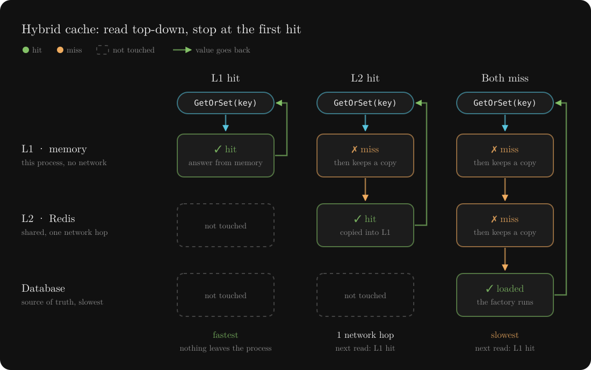
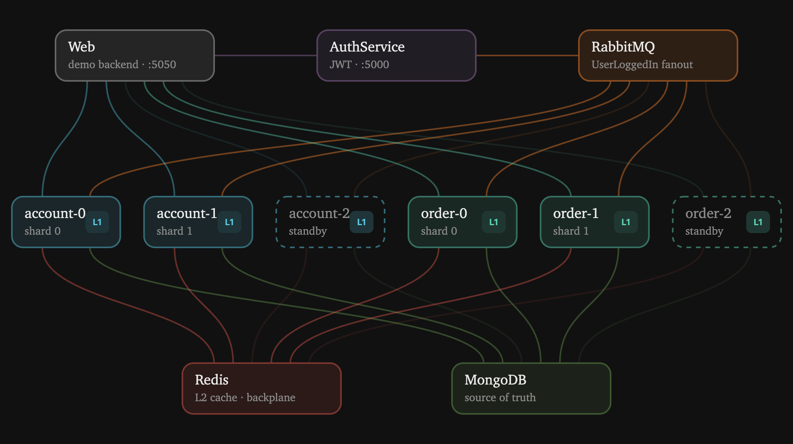
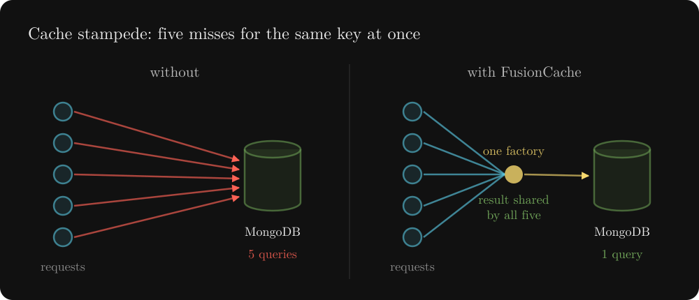
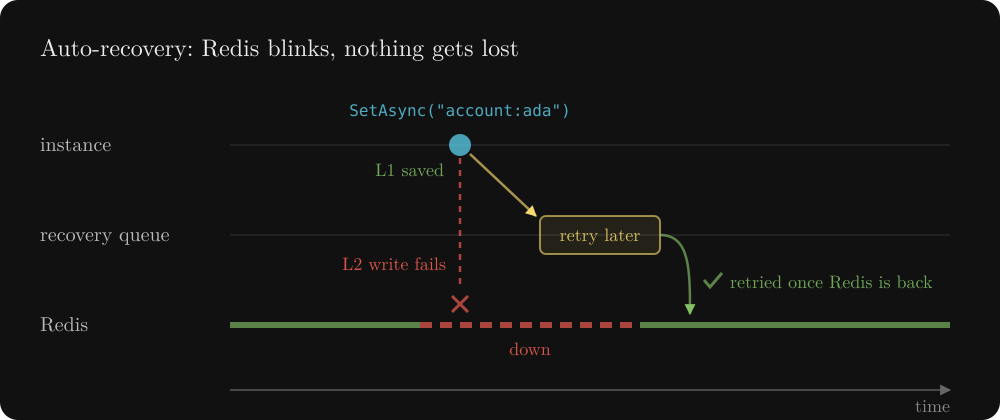
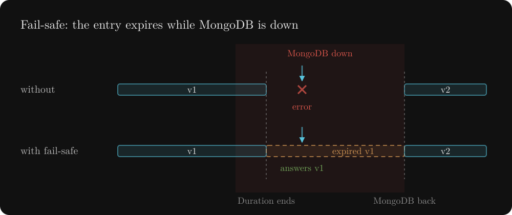
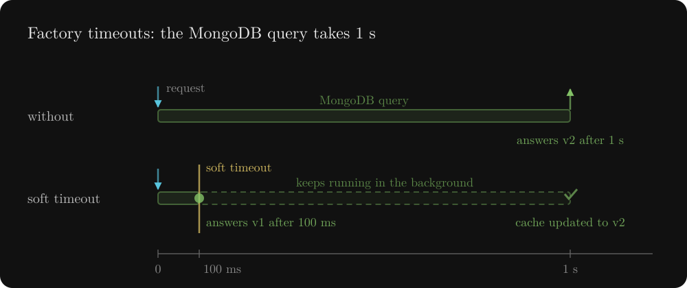
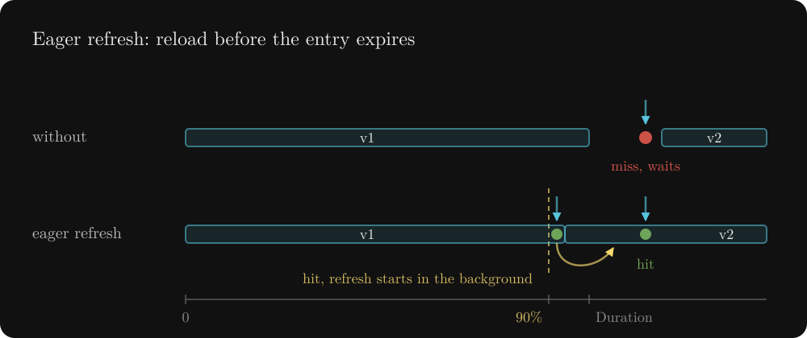
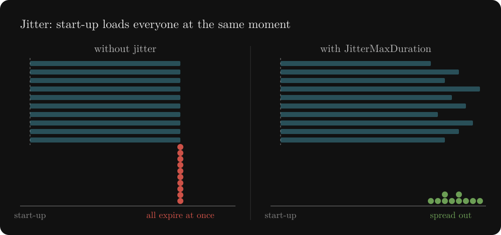

# When everything stops fitting

In the [previous post](/recovering-service-caches/) every replica kept the **complete** product catalog in memory. Reads never touched the database, and a careful recovery protocol made sure a fresh replica didn't answer with stale data. For a catalog of entity with reasonable size it's hard to beat in performance.

Now let's consider bigger size:

- 500k users,
- ~10 KB of cached data per user (an account and its order history),
- 3 regions,
- 5 instances per region, so 15 in total.

Nothing crazy. Now load the whole universe into every instance, and it gets expensive quickly:

- **Memory.** Each instance holds **5 GB** of cache. Across all 15 instances that's **75 GB of RAM** holding the same 5 GB, 15 times.
- **Rehydration time.** A fresh instance isn't useful until all 500k users are loaded, and every deploy restarts all 15 of them. Every change of a single user has to reach 15 copies in three regions, too.
- **Performance.** A big cache is a big, long-lived heap. Every full (gen 2) [garbage collection](https://learn.microsoft.com/en-us/dotnet/standard/garbage-collection/fundamentals) has to walk everything that's still alive, and a cache is exactly that: lots of objects that never die. The more memory we hold, the more work for the GC and the less room for the requests we're actually serving. Size also changes how we store and search the data. For a small cache, a `ConcurrentDictionary` and a bit of LINQ over its values are enough in most cases. With 5 GB of it, we need smarter structures even in memory: compact layouts that keep the object count down, and our own indexes for every search that isn't by key. That's a small database we now have to write and maintain.

And most of it is never read. If our user lives in Warsaw, the European region handles almost all of their requests. The instances in Virginia and Singapore don't need that data at all, and it's never going to be hot there, that's for sure.

So the question for this post is: **what if every instance cached only the users it owns?** Give each user one owner instance in their home region, and the 15 instances share **5 GB** between them, about **350 MB** each, instead of 5 GB each. Cache only the users who are actually active, and it's even less.

What makes it possible is a difference from the [previous post](/recovering-service-caches/). There, the cache was the *only* read path, so a cold cache was a **correctness problem**: the replica had to refuse traffic until it caught up. Here we use a hybrid cache, which falls back to Redis and then to the database. A cold cache is only a **latency problem**. A miss is slower, never wrong. That changes everything about what we can afford *not* to load.

That doesn't mean a fresh instance has to start cold, though. We can still rehydrate on start, the same way as last time, just with two filters on top: **each instance loads only the users it owns, and only the ones who are logged in right now.** That's a fraction of the users instead of all 500k. Everyone else takes the miss on their first request. The demo skips it to keep the code short, but nothing in the design stands in the way.

# Hybrid cache in one screen

A hybrid cache has two levels and one messenger:

- **L1** is the instance's own memory. No network, fastest possible read, but private to one process.
- **L2** is Redis, shared between instances. One network hop, and it survives restarts and deploys.
- **The backplane** is Redis pub/sub. When one instance changes an entry, the others hear about it.

A read goes top-down and stops at the first hit. Whatever had to come from further down is saved to the levels above it on the way back, so the next read of the same key is an L1 hit:



## Microsoft's HybridCache

.NET has its own [`HybridCache`](https://learn.microsoft.com/en-us/aspnet/core/performance/caching/hybrid?view=aspnetcore-10.0) with L1, L2 and stampede protection. What it doesn't have is a backplane, and the docs say it plainly:

> When invalidating cache entries by key or by tags, they're invalidated in the current server and in the secondary out-of-process storage. However, the in-memory cache in other servers isn't affected.

That's exactly the case we have to handle, because a user's data will live in more than one L1. [FusionCache](https://github.com/ZiggyCreatures/FusionCache) has a backplane, and the same Microsoft page mentions it as an alternative implementation. If you prefer to code against the abstraction, [`.AsHybridCache()`](https://github.com/ZiggyCreatures/FusionCache/blob/main/docs/MicrosoftHybridCache.md) registers FusionCache as `HybridCache`. In the demo I'll use `IFusionCache` directly.

# The demo

Before any code, a quick look at what we're building. Two services cache user data, **accounts** and **orders**, with a few helpers around them:



- **AuthService** issues JWTs and publishes `UserLoggedIn` to a RabbitMQ fanout exchange.
- **account-N** and **order-N** are gRPC services, each running in multiple instances with their own L1. They share Redis for L2 and the backplane, and MongoDB as the source of truth.
- **Web** serves the page and forwards its calls.

That's one region. The demo runs it twice, as **eu** and **us**, and each user's data lives in just one of them. We'll get there [at the end](#going-multi-region). Until then, we stay inside one region.

[Aspire](https://aspire.dev) boots it all. Clone [the repo](https://github.com/bulatgrzegorz/hydrid-cache), and one `dotnet run --project AppHost` or `aspire run` starts every service instance in both regions, plus each region's Redis, RabbitMQ and MongoDB, and one Kafka with Debezium, in containers, and hands each service its connection strings. That's where the `"redis"` in the next snippet comes from. Once it's up, the demo page is at `http://localhost:5050`.

## FusionCache setup

The whole setup, in every account and order instance:

```csharp
builder.AddRedisDistributedCache("redis");
builder.Services.AddFusionCache()
    .WithOptions(o => o.BackplaneChannelPrefix = builder.Environment.ApplicationName)
    .WithDefaultEntryOptions(o =>
    {
        o.Duration = TimeSpan.FromMinutes(2);            // L2 (Redis)
        o.MemoryCacheDuration = TimeSpan.FromMinutes(1); // L1 (memory)
    })
    .WithSerializer(new FusionCacheSystemTextJsonSerializer())
    .WithRegisteredDistributedCache()
    .WithStackExchangeRedisBackplane(o => o.Configuration = builder.Configuration.GetConnectionString("redis"));
```

`AddRedisDistributedCache("redis")` is Aspire's Redis integration: it takes the connection string AppHost passed in and registers Redis as `IDistributedCache`. `WithRegisteredDistributedCache()` picks that up as L2, and `WithStackExchangeRedisBackplane` adds the backplane on the same Redis.

L2 outlives L1, so when a copy runs out of memory, the next read falls back to Redis, not MongoDB. Both are short so that evictions show up while you watch the demo. In production you can pick much longer ones.

## What FusionCache does under the hood

That setup looks small, but FusionCache does a lot that never shows up in our code. Some of it is on by default:

- **Cache stampede protection.** When 100 requests miss the same key at once, [only one factory runs](https://github.com/ZiggyCreatures/FusionCache/blob/main/docs/CacheStampede.md) and all 100 callers get its result. In our design it happens more often than you'd think: the login warm-up and the user's first request race for the same key on the same instance, and MongoDB still gets a single query. The protection is per instance. A distributed locker extends it across instances, but the docs themselves say you rarely need one.

  
- **Auto-recovery.** Redis restarts, or the network blips. A value that made it into L1 but not into L2, or a backplane message that never went out, goes into a queue and is [retried](https://github.com/ZiggyCreatures/FusionCache/blob/main/docs/AutoRecovery.md) until Redis answers again. Without it, a few seconds of Redis trouble would leave instances out of sync until their copies expire.

  

And some of it is one option away. The demo doesn't turn any of these on:

- **Fail-safe.** When an entry expires and MongoDB is down, FusionCache [can serve the expired value](https://github.com/ZiggyCreatures/FusionCache/blob/main/docs/FailSafe.md) instead of an error, and try again later. It's a trade: slightly stale, but available. A database outage stops being an outage for every user who's already cached.

  
- **Factory timeouts.** Together with fail-safe, a [soft timeout](https://github.com/ZiggyCreatures/FusionCache/blob/main/docs/Timeouts.md) returns the old value when MongoDB is slow, and lets the query finish in the background to update the cache.

  
- **Eager refresh.** With `EagerRefreshThreshold = 0.9`, a request that comes in after 90% of the duration [triggers a background refresh](https://github.com/ZiggyCreatures/FusionCache/blob/main/docs/EagerRefresh.md), so a user who's active all the time never hits an expired entry.

  
- **Jitter.** `JitterMaxDuration` adds a random bit to every duration. Remember rehydrating on start? Every user loaded in the same second would also expire in the same second. Jitter spreads them out.

  

# Who owns a user

Sharding needs one function that every instance agrees on: user in, shard out.

```csharp
public static uint Hash(string s) => BitConverter.ToUInt32(MD5.HashData(Encoding.UTF8.GetBytes(s)));

var owner = (int)(Hash(userId) % shards);
```

Why not `userId.GetHashCode() % shards`? Because `string.GetHashCode` is [randomized per process](https://learn.microsoft.com/en-us/dotnet/api/system.string.gethashcode#remarks) in .NET, so two instances would disagree on who owns `ada`. MD5 isn't here for security, only for a stable, well-spread number.

`% shards` is the simplest choice, and the demo's default. It's also the worst one the day the shard count changes, but we'll [get to that](#adding-a-shard).

In production the owner should be picked *before* the request reaches the service: a gateway or the calling service reads the user id from the JWT and hashes it the same way. In the demo, the page lets you pick the shard yourself, so you can see what happens on both the right and the wrong one.

# Walking through the demo

The scenes up to [the regions part](#going-multi-region) happen inside one region, so their recordings show just one.

With 2 shards, our user `ada` lands on shard 0: `md5("ada") % 2 == 0`. So account-0 and order-0 are her owners.

## No token, no entry

<video src="/assets/img/posts/sharding-hybrid-cache/rejected.mp4" autoplay loop muted playsinline controls aria-label="A call without a JWT is rejected"></video>

Before logging in, **Get account** goes to account-0 without a JWT, and gRPC rejects it with `Unauthenticated`. That's not only demo decoration: the user id (our shard key) always comes from the signed token, never from the request body.

## Warming the cache on login

Everything so far works without any warm-up. The first **Get account** on the owner misses L1, misses L2, loads `ada` from MongoDB and saves her to both levels. The cache is correct, the user just waits a little longer on that first call.

**Warm-up only moves that miss to a moment the user doesn't wait for.** She has just logged in, and her next request is coming in a second. Why not load her right now, on the instance that will serve her?

<video src="/assets/img/posts/sharding-hybrid-cache/login.mp4" autoplay loop muted playsinline controls aria-label="Logging in: JWT, RabbitMQ fanout, and the owner shard warming its cache"></video>

1. AuthService issues the JWT and publishes `UserLoggedIn`. The page gets its token right away, the rest happens in the background.
2. RabbitMQ delivers the message to every instance, the standby ones too, and each one checks whether `ada` is its user. account-0 and order-0 start warming, the rest ignore it.
3. The owners miss L1 and L2, load her from MongoDB and save her to both.
4. Saving also sends a backplane message. The other instances hear it, but they hold no copy, so there's nothing to refresh.

In code, the warm-up isn't a separate mechanism. It's the same `Load` the service already uses for reads, just called before anyone asks:

```csharp
await app.HydrateOnLogin(app.Services.GetRequiredService<AccountsApi>().Load);
```

And inside `HydrateOnLogin`, every instance gets every login and keeps only its own users:

```csharp
consumer.ReceivedAsync += async (_, e) =>
{
    var userId = Encoding.UTF8.GetString(e.Body.Span);
    var owner = GetOwnerOf(userId);
    if (owner != shard) return;
    await hydrate(userId);
};
```

`Cluster` is the shard count and the routing strategy, kept in Redis, so every instance routes the same way even when we change them mid-demo.

`GetOwnerOf` is the hashing algorithm, and the shard comes from configuration, an environment variable the deployment keeps up to date, so every instance knows it.

That `Load` is a plain `GetOrSetAsync`. The factory runs only when both L1 and L2 miss:

```csharp
public async Task<AccountDoc> Load(string userId) =>
    await cache.GetOrSetAsync($"account:{userId}", async ct =>
        await _accounts.Find(a => a.Id == userId).FirstOrDefaultAsync(ct));
```

## Owner shard: an L1 hit

<video src="/assets/img/posts/sharding-hybrid-cache/hit.mp4" autoplay loop muted playsinline controls aria-label="Get account on the owner shard is answered from memory"></video>

**Get account** on account-0. Login already put `ada` into its memory, so it's an L1 hit, answered without a single network hop. **This is the path the whole design is built for.**

## Wrong shard: slower, still correct

Requests *shouldn't* land on the wrong shard. But sometimes they will: an instance is restarting, a gateway falls back to any healthy instance, or a caller simply doesn't know about sharding. That's fine, because it works out of the box:

<video src="/assets/img/posts/sharding-hybrid-cache/wrong-shard.mp4" autoplay loop muted playsinline controls aria-label="Get account on a shard that doesn't own the user goes to Redis"></video>

account-1 has never seen `ada`, so L1 misses. But Redis has the copy the owner saved at login, so L2 hits and the value is copied into account-1's memory. No database trip, just one network hop the owner would have skipped.

That copy stays in account-1's L1 until it expires. It's a small dent in "each instance holds only its own users", but fallbacks are rare, the copy expires on its own, and, as the next scene shows, the backplane keeps it correct in the meantime.

## One update, every copy

Writes go to the owner, and the source of truth comes first:

```csharp
var doc = new AccountDoc(context.UserId(), request.Name, request.Email);
await _accounts.ReplaceOneAsync(a => a.Id == doc.Id, doc, new ReplaceOptions { IsUpsert = true });
await cache.SetAsync($"account:{doc.Id}", doc);
```

<video src="/assets/img/posts/sharding-hybrid-cache/update.mp4" autoplay loop muted playsinline controls aria-label="Update account: MongoDB, L1 + L2, then the backplane refreshes the stale copy on the other instance"></video>

1. account-0 writes MongoDB, then L1 + L2.
2. `SetAsync` publishes a backplane message saying `account:ada` changed.
3. account-1 and account-2 hear it. account-2 holds no copy, so there's nothing to do. The wrong-shard read left account-1 holding one, which is now stale, so it [refreshes that copy from Redis](https://github.com/ZiggyCreatures/FusionCache/blob/main/docs/Backplane.md).

No instance serves the old value, and nobody had to go back to the database for the new one.

What's important for sharding is *who does the work*. Every instance receives the message, but **only the instances that hold a copy do anything**. With sharding, that's the owner plus the rare fallback copy, not all 15 instances.

# Adding a shard

So far the shard count was fixed. In real life it isn't: traffic grows, and one day 2 shards have to become 3. The routing function decides how many users get a new owner that day, and every user who moves starts cold on the new one.

The demo keeps the shard count and the routing strategy in Redis, and the page's **Cluster** panel changes both live. There are three strategies to pick from. Each one takes a user and the shard count and returns the owner, and all three use the same `Hash` as [before](#who-owns-a-user). In the repo they sit in one switch in [`Cluster.cs`](https://github.com/bulatgrzegorz/hydrid-cache/blob/main/Shared/Cluster.cs).

Each recording below starts the same way: 2 shards, six users logged in, and `ada` warm on her owner. Then a third shard joins, and `ada` makes her next call.

## Modulo: most users move

The one we started with: divide the user's hash by the shard count, and the remainder is the owner.

```csharp
int OwnerByModulo(string userId, int shards) => (int)(Hash(userId) % shards);
```

<video src="/assets/img/posts/sharding-hybrid-cache/scale-modulo.mp4" autoplay loop muted playsinline controls aria-label="Scaling out under modulo: the clock repaints, 4 of 6 users move, and ada's next call misses L1 on her new owner"></video>

With 2 shards, a user's owner is `hash % 2`. With 3, it's `hash % 3`. The user keeps their owner only if both give the same number. Take the hashes 0 to 5:

| hash | 0 | 1 | 2 | 3 | 4 | 5 |
|---|---|---|---|---|---|---|
| owner with 2 shards | 0 | 1 | 0 | 1 | 0 | 1 |
| owner with 3 shards | 0 | 1 | 2 | 0 | 1 | 2 |

Only hashes 0 and 1 stay where they were. Hash 3 even moves from shard 1 to shard 0, two shards that were there all along. The pattern repeats every 6 hashes, so **two thirds of all users get a new owner**. Here it's 4 of 6 users, and 64% of the test users.

That's twice as many as needed. With 3 shards, each one should own a third of the users. The new shard starts with none, so a third of the users have to move to it, and everyone else could stay where they were.

`ada` is one of the movers: her call lands on account-1, which has never seen her. L1 misses, and Redis answers.

## Consistent hashing: only the new shard's slice moves

Picture every possible `uint` hash on a circle, from 0 all the way around to `uint.MaxValue` and back to 0. Every shard gets a point on that circle, and a user belongs to the first shard point clockwise from their own hash. Here's the circle before and after a third shard joins:


*(In a real ring nobody places the points by hand. Each one is the hash of the shard's name, like `Hash($"shard-{shard}")` in the code below, so it lands on a random-looking spot, and every instance computes the same one. The diagram and the demo use fixed spots instead: shard 0 at the top, shard 1 half a turn later, shard 2 at a quarter, so the points never crowd together on the page.)*

In code, the user just measures the clockwise distance to every point:

```csharp
int OwnerOnRing(string userId, int shards)
{
    var user = Hash(userId);
    var owner = 0;
    var closest = uint.MaxValue;
    for (var shard = 0; shard < shards; shard++)
    {
        var point = Hash($"shard-{shard}");
        var distance = point - user;
        if (distance < closest) (owner, closest) = (shard, distance);
    }
    return owner;
}
```

`point - user` is the clockwise distance from the user to the shard. `uint` subtraction wraps around, so a point just *behind* the user comes out as almost a full turn away. The closest point wins.

<video src="/assets/img/posts/sharding-hybrid-cache/scale-ring.mp4" autoplay loop muted playsinline controls aria-label="Scaling out under consistent hashing: shard 2's slice sweeps in, 2 of 6 users move, and ada's next call is an L1 hit"></video>

A new point takes over only the slice that ends at it, so only the users in that slice move: 2 of 6 here, 25% of the test users. `ada` isn't one of them, so her call is still an L1 hit.

The load bar shows the catch. The new point splits only one neighbor's slice, so shard 0 still holds half the users, while shards 1 and 2 share the other half. That's why real rings give every shard many virtual points. (The 50/25/25 comes from the demo's fixed spots. With hashed points, the split is whatever the hash happens to give.)

## Rendezvous hashing: few move, and the load stays even

Rendezvous hashing, or highest random weight (HRW), skips the circle. Every shard scores the user by hashing the user id together with the shard number, and the highest score wins:

```csharp
int OwnerByRendezvous(string userId, int shards)
{
    var owner = 0;
    var best = 0u;
    for (var shard = 0; shard < shards; shard++)
    {
        var score = Hash($"{userId}/{shard}");
        if (score > best) (owner, best) = (shard, score);
    }
    return owner;
}
```

A score depends only on the user and the shard, never on how many shards there are. So adding a shard doesn't change any existing score, it only adds one more to compare.


<video src="/assets/img/posts/sharding-hybrid-cache/scale-hrw.mp4" autoplay loop muted playsinline controls aria-label="Scaling out under HRW: shard 2 slots into every user's ranking, 2 of 6 users move, and ada's next call is an L1 hit"></video>

A new shard enters every user's ranking, but it takes only the users who rank it first: 2 of 6 here, 34% of the test users, just the third an even split needs. `ada` stays on account-1 with an L1 hit, and every shard keeps a third of the load, no virtual points needed.

The price is scoring every shard on every lookup, where a ring can binary-search its points. With a handful of shards per region, that's nothing.

Whichever strategy you pick, nothing gets migrated. A user who moves misses L1 on the new owner and Redis answers, while the old owner's copy simply expires. Even a bad reshard costs Redis hops, not database load.

# Going multi-region

The demo works with two regions: **eu** and **us**.

**Each region runs its own copy of everything**: AuthService, RabbitMQ, the shards, Redis and MongoDB. Nothing is shared between them, not even the backplane. Redis pub/sub doesn't cross regions, and you don't want your L2 an ocean away anyway.

The data is different. **A user's data lives in one place only: their home region's MongoDB.** There's no copy of it in the other region. When a request for that user lands in the other region, its shards read and write the home database across the ocean. And Debezium streams both MongoDBs into Kafka, which is how a region finds out that something it cached has changed:


## Which region serves a user

In production, a global load balancer sends each request to the nearest region, and inside it the same hash picks the shard. The owner is simply *(region, shard)* instead of *shard*. Most of the time that's the user's home region, because most people don't travel that much.

Which region is home usually isn't your services' problem either. The identity provider already knows every user, so the home region is one more attribute on them, set at sign-up and put into the token as a claim. Make it one the user can't edit, since it decides where their data lives.

The demo has no identity provider, so AuthService plays one: **the home region is where the user first logged in.** That first login signs them up there, and AuthService puts the region into the JWT as a `home` claim. Web plays the load balancer, and the page's **Region** picker says where your calls go. Both regions trust the same signing key, so the token works in either. So here's `ada`, signed up in eu, running **Get account** in us:

<video src="/assets/img/posts/sharding-hybrid-cache/other-region.mp4" autoplay loop muted playsinline controls aria-label="Get account in us: L1 and Redis miss, and the read crosses to eu's MongoDB, ada's home"></video>

L1 and Redis both miss, and the read crosses to eu's MongoDB. It's the wrong-shard fallback, one level deeper and an ocean further away. us then saves the value to its own L1 + L2, so the next read there is a hit. It also leaves account-1 in us holding a copy, and that copy matters in a moment.

**Logging in elsewhere doesn't move the home.** Someone from Warsaw flies to Singapore for a week and logs in there. Asia's AuthService finds them already signed up in Europe, so the token still says `home: eu`. Asia's owner shard warms up from Europe's MongoDB, exactly like a login in the demo, and from then on its L1 answers most of their requests. Only the misses and the writes cross the ocean. Moving someone's home for good means moving their data, and the demo doesn't do that.

## Reads and writes go home

Two small pieces carry it. `HomeDatabase` knows every region's MongoDB, and turns the token's `home` claim into the database to use:

```csharp
public class HomeDatabase(IConfiguration config, IMongoDatabase own)
{
    public readonly string Region = config["REGION"]!;
    readonly Dictionary<string, IMongoDatabase> databases = /* every region's MongoDB, by region; this region's is own */;

    public IMongoDatabase this[string home] => databases[home];
}
```

For a user at home, that's the region's own database, so nothing changes for them. And `Load`, the same one login warms the cache with, gets the home region as a parameter:

```csharp
public async Task<AccountDoc> Load(string userId, string home) =>
    await cache.GetOrSetAsync($"account:{userId}", async ct =>
        await AccountsIn(home).Find(a => a.Id == userId).FirstOrDefaultAsync(ct) ?? new AccountDoc(userId, "", ""));

public override async Task<Account> Get(Empty request, ServerCallContext context) =>
    ToProto(await Load(context.UserId(), context.HomeRegion()));
```

`AccountsIn(home)` is just `dbs[home].GetCollection<AccountDoc>("accounts")`. Writes go home too, and every document now records the region that wrote it, in `writtenBy`:

```csharp
var (doc, home) = (new AccountDoc(context.UserId(), request.Name, request.Email, dbs.Region), context.HomeRegion());
await AccountsIn(home).ReplaceOneAsync(a => a.Id == doc.Id, doc, new ReplaceOptions { IsUpsert = true });
await cache.SetAsync($"account:{doc.Id}", doc);
```

The cache itself doesn't change at all. The key is the same in every region, and `GetOrSetAsync` doesn't care which database its factory reads. And since there's only one copy of the data, there's nothing to keep in sync and nothing to conflict: every write for `ada` lands in the same database.

## The catch: a stale copy in the other region

Remember the copy us cached a moment ago? Now `ada` updates her account in eu. eu writes its MongoDB, saves L1 + L2, and its backplane tells the other eu instances. But us keeps serving its cached copy until it expires.

Nobody told us's caches. The backplane only reaches its own region, and the write never went through us at all.

## The fix: evict from the change feed

The database sees every write, so let it tell everyone. [Debezium](https://debezium.io/) reads each region's MongoDB [change stream](https://www.mongodb.com/docs/manual/changestreams/) and publishes every change to Kafka, one topic per collection: `eu.accounts.accounts`, `us.orders.orders`. AppHost registers one connector per region through Kafka Connect's REST API, once Debezium is up:

```csharp
["connector.class"] = "io.debezium.connector.mongodb.MongoDbConnector",
["topic.prefix"] = region,
["collection.include.list"] = "accounts.accounts,orders.orders",
["capture.mode"] = "change_streams_update_full", // an update carries the whole document
["snapshot.mode"] = "no_data",                   // changes from now on, not what's already there
```

In each region, every instance of a service joins one Kafka consumer group (`eu-account`, `us-order`, ...) for the topics of **every** region. Kafka gives the feed to one of them, and that one evicts the changes another region wrote:

```csharp
var change = consumer.Consume(stopping);
var after = change.Message.Value is { } value ? JsonNode.Parse(value)!["after"]?.GetValue<string>() : null;
if (after is not null)
{
    var doc = BsonDocument.Parse(after);
    var (userId, writer) = (doc[userField].AsString, doc.GetValue(WrittenBy, "").AsString);
    if (writer != region) await evict(userId);
}
consumer.Commit(change);
```

And the service hands it a one-line `Evict`:

```csharp
public Task Evict(string userId) => cache.RemoveAsync($"account:{userId}").AsTask();
```

`RemoveAsync` clears L1 and Redis, and its backplane message drops every other copy in the region. The next read there misses both levels and loads the new value from the home database.

A few choices hide in those lines:

- **Other regions' writes, in any database.** A write in eu evicts us's copies. A write *from* us lands in eu's MongoDB, and evicts eu's copies. The writer has already saved the new value with `SetAsync`, so `writtenBy` lets it skip its own writes. Evicting those too would add a database read after every write.
- **One instance per region and service.** Eviction doesn't need the user's owner. Any instance's `RemoveAsync` clears Redis, and its backplane message clears every L1. So the consumer group lets Kafka pick one, and another one when that one stops.
- **Evict, don't refresh.** Users mostly stay in their home region, so the other one rarely holds a copy. Evicting a key nobody cached costs one Redis delete and one pub/sub message. Refreshing would reload every changed user in every region, even for users who never go there.
- **Never early.** Every region reads a user from the same database, the home one, and its change stream reports a write only once the database has it. So any read after the eviction gets the new value.
- **Nothing gets lost.** Kafka keeps the topic, and the offset is committed only after the eviction. When the instance reading the feed stops, another one in the group takes over where it left off. A clean stop hands the feed over at once; after a crash, Kafka first waits for the old consumer's session to time out.

Here's `ada` back in eu, updating her name while us still holds that copy:

<video src="/assets/img/posts/sharding-hybrid-cache/evict.mp4" autoplay loop muted playsinline controls aria-label="Update account in eu: Debezium hands the change to Kafka, and an instance in us evicts the cached copy"></video>

1. eu-account-0 writes MongoDB, saves L1 + L2 and sends eu's backplane message, as before.
2. Debezium hands the change to Kafka.
3. us's account-0, the instance Kafka gave the feed to, reads it and evicts `account:ada` from L1 and Redis.
4. Its backplane message tells the other us instances to drop their copies, account-1's included.

Back in us, the next **Get account** plays exactly like the first one: L1 and Redis miss, and the read crosses to eu's MongoDB, only now it comes back with the new name.

The same rule works the other way round. Here's `ada` in us, updating her name again:

<video src="/assets/img/posts/sharding-hybrid-cache/away-write.mp4" autoplay loop muted playsinline controls aria-label="Update account in us: the write crosses to eu's MongoDB, us saves its own copy, and eu evicts its copies through Kafka"></video>

The write crosses to eu's MongoDB, and us saves the new value to its own L1 + L2. Then Debezium reports the change, eu's account-0 evicts `account:ada`, and eu's backplane drops the other copies. us skips the event, because it wrote it.

## Why not replicate?

The obvious alternative is to copy every user's data into every region, so a miss never crosses the ocean. The stale copy doesn't go away, though, and it gets an ordering problem on top. Each region now reads its *own* copy, so an eviction has to wait until the replicated write has landed there. Evict on the source's change, and the next read in us can reload the old value from a copy that hasn't caught up yet.

Facebook described exactly that in [Scaling Memcache at Facebook](https://www.usenix.org/system/files/conference/nsdi13/nsdi13-final170_update.pdf) (NSDI 2013). Their regions read local replicas. An invalidation daemon, mcsqueal, runs on every database, reads the statements it commits, and sends the deletes to every cache cluster in its region. They delete instead of update "because deletes are idempotent". And they invalidate from the database side because a web server invalidating another region directly "will race with the replication stream".

When even that isn't enough, after a user writes from outside the master region, a "remote marker" sends their reads to the master region until replication catches up. In the paper's words, "we explicitly trade additional latency when there is a cache miss, for a decreased probability of reading stale data." The demo makes that trade on every miss outside the home region. One more number from the paper: "only 4% of all deletes issued result in the actual invalidation of cached data". That's why an eviction has to be cheap when there's nothing to evict.

A production system still keeps copies, for disaster recovery: lose the home region's MongoDB, and nobody can serve that user. That's the database's job, and every database does it its own way:

- **MongoDB**: a [replica set can span regions](https://www.mongodb.com/docs/manual/core/replica-set-architecture-geographically-distributed/), with one primary taking every write. Atlas [Global Clusters](https://www.mongodb.com/docs/atlas/global-clusters/) shard by location and give each zone its own primary near its users, which is the demo's home region, done by the database. (`mongosync` copies one cluster into another, but its docs say not to use it to keep a secondary cluster.)
- **PostgreSQL**: [standby servers](https://www.postgresql.org/docs/current/warm-standby.html) fed by streaming replication, or built-in [logical replication](https://www.postgresql.org/docs/current/logical-replication.html). Two-way logical replication works since PostgreSQL 16 with `origin = none`, but conflicts stay yours: an update to a row the other side changed meanwhile is applied anyway, and a duplicate key [stops replication](https://www.postgresql.org/docs/current/logical-replication-conflicts.html) until someone fixes it by hand. For multi-master with conflict handling, there's EDB Postgres Distributed, or pgEdge's open-source Spock.
- **Managed databases** do it for you: DynamoDB global tables, Cosmos DB multi-region writes, or Aurora Global Database with one writer region and read-only copies in the others.

The caches don't need to know about those copies, as long as nobody reads from them.

# What the demo doesn't solve

This is a demo, and it takes shortcuts that a huge system can't:

- **Movers start cold.** A reshard doesn't warm anyone. Users who move pay one Redis hop on their first call to the new owner, and their warm-up waits until they log in again.
- **Fanout per login.** Every instance gets every login and throws away all but its own. With 5 shards in a region, a direct exchange using the shard as the routing key would deliver each login once instead of five times.
- **Lost warm-ups.** Each instance listens on a throwaway queue, so logins that happen while a shard is down are lost. That's not a correctness issue, the user just takes the cold path once. Rehydrating on start, as mentioned at the beginning, would pick those users up again.
- **Write, then cache.** If the process dies between the MongoDB write and `SetAsync`, L1 and L2 keep the old value until it expires (two minutes here).
- **No disaster-recovery copy.** A user's data lives in one MongoDB. If eu's database is down, no region can serve eu users' misses or writes. Production keeps replicas, as above. Real cross-region replication is a whole separate post 😅
- **Sign-up by asking around.** AuthService finds a user's home by asking every region's MongoDB, and two first logins in two regions at the same moment sign the user up twice. In production, the identity provider is that one global directory, and the home region comes in the token.
- **One Kafka for both regions.** In production each region runs its own Kafka next to its database, and MirrorMaker 2 copies the topics across. Kafka [recommends running it next to the cluster it writes to](https://kafka.apache.org/39/operations/geo-replication-cross-cluster-data-mirroring/), because "Kafka producers typically struggle more with unreliable or high-latency network connections than Kafka consumers."
- **Free ocean.** Both regions run on one laptop, so the read from eu costs nothing you can see. In production it's a round trip across the ocean on every miss outside the home region.
- **Stale-set race.** A read in us that starts just before a write can put the old value back right after the eviction. Facebook closes that window with leases.
- **Auth.** There are no passwords: any name gets a token.

# Wrapping up

Keeping everything in memory everywhere is a great design until "everything" stops being small and "everywhere" means three regions. At that point, the question changes from *"how do I load it all?"* to *"which instance should hold this user, and what happens when the request lands somewhere else?"*

A hybrid cache answers the second half for free: a miss is slower, never wrong. Sharding by user gives you the hit rate, so the owner answers from memory, and rendezvous hashing keeps most of it when you add a shard. The backplane keeps the occasional extra copy honest. Across regions, each user's data lives in one place, and that database's own change feed tells every other region what to evict. And warming on login is the cherry on top that hides the first miss from the user.

The full, runnable demo with all the scenes above (.NET 10, FusionCache, Redis, RabbitMQ, MongoDB, Kafka, Debezium and Aspire) is [in this repo](https://github.com/bulatgrzegorz/hydrid-cache). One `dotnet run --project AppHost`, and you can watch the dots yourself 🚀
